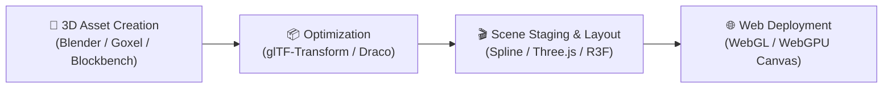

  

# Awesome 3D Diorama Creation & Scene Composition 🎨✨

**A curated index of top-tier SaaS platforms, cloud editors, open-source 3D engines, voxel modelers, procedural diorama generators, and WebGL/WebGPU scene composition ecosystems.**

[Explore SaaS](#-saas--hosted-platforms) • [Open-Source Projects](#-open-source-github-projects) • [Market Dynamics](#-sector-overview--market-dynamics) • [Contributing](#-how-to-contribute) • [Support](#-support)

---

## 📖 Overview

The **3D Diorama Creation & Scene Composition** ecosystem encompasses real-time tools, browser-native staging environments, voxel sculptors, procedural scattering pipelines, and generative 3D frameworks. Whether staging miniature isometric fantasy rooms, sculpting low-poly game assets, kitbashing modular architectural scenes, or publishing interactive WebGL/WebGPU showcases, this collection catalogs category-leading hosted services and battle-tested open-source repositories.

---

## 📊 Sector Overview & Market Dynamics

> The global 3D modeling, rendering, and virtual scene creation market is valued at approximately **$8.6B to $9.6B in 2026** (expanding toward $14B+ across industrial CAD/DCC segments at a ~14% CAGR). The market structure is **moderately fragmented**: enterprise CAD and flagship VFX pipelines remain concentrated under legacy giants (Autodesk, Epic Games), while the lightweight browser-based 3D diorama, WebGL scene composition, and indie voxel niches are highly dynamic and contested by agile venture-backed startups (Spline, Vectary, Womp) alongside dominant open-source community standards (Blender, Godot, Three.js).

---

## ☁️ SaaS & Hosted Platforms

The following hosted platforms and cloud-native 3D scene studios provide real-time collaborative editing, interactive browser rendering, lighting baking, and asset hosting. 

*Entries are ordered descending by company valuation / parent revenue scale.*

| Product | Valuation / Revenue Scale | Starting Tier Price | Free Forever Tier Limit / Free Trial | Key Features |
| :--- | :--- | :--- | :--- | :--- |
| **[Autodesk Tinkercad](https://tinkercad.com)** | **$55B+ Market Cap** (~$7.8B Annual Rev) | **$0.00 / mo** (100% Free Service) | **Free Forever**: Full toolset access (3D Design, Circuits, Codeblocks, Sim Lab) with zero subscription fees | Browser-based CSG solid modeling, block-building, direct 3D printing export (STL/OBJ), and educational collaborative classrooms. |
| **[Sketchfab](https://sketchfab.com)** | **$100M+ Acquisition** (Epic Games / KitBash) | **$15.00 / mo** (Pro plan, billed annually) | **Free Forever (Basic)**: Standard public uploads capped at 100MB per model and up to 10 uploads/month | Industry standard WebGL/WebGPU 3D model viewer, PBR inspector, post-processing filters, annotations, and VR/AR preview. |
| **[Spline](https://spline.design)** | **~$50M – $100M Valuation** (~$32M Raised) | **$12.00 / seat/mo** (Hobby, billed annually; $15/mo monthly) | **Free Forever**: Limited personal files, 0 AI generation credits, exports include Spline watermark | Real-time collaborative browser 3D design, interactive isometric dioramas, physics events, materials, and embeddable code. |
| **[PlayCanvas](https://playcanvas.com)** | **Subsidiary of Snap Inc.** (Acquired) | **$15.00 / user/mo** (Personal plan) | **Free Forever**: Unlimited public projects, 1 GB cloud storage limit, community forum support | Cloud-hosted WebGL/WebGPU game and scene engine, collaborative script editor, lightmap baking, and glTF scene pipeline. |
| **[Vectary](https://vectary.com)** | **~$29M – $37M Valuation** (~$14M Raised) | **$25.00 / mo** (Starter plan) | **Free Forever**: Capped at 5 active projects, 1 workspace seat, standard asset library | Cloud 3D canvas and procedural scene assembler with Figma integration, photorealistic materials, and instant AR embeds. |
| **[Womp](https://womp.com)** | **~$5M – $10M Seed Stage** (~$3M Raised) | **$9.99 / mo** (Pro plan) | **Free Forever (Starter)**: 300 daily AI credits, 150MB mesh uploads, HD exports, core SDF modeling | Liquid Signed Distance Field (SDF) 3D modeling, intuitive real-time Boolean blending, gooey stylized shaders, and 3D print exports. |
| **[3D Slash](https://3dslash.net)** | **Bootstrapped / Indie Scale** (<$2M Rev) | **$2.00 / mo** (Premium plan; $24/yr) | **Free Forever**: Browser-only access, limited palette of 8 colors, queued/delayed exports | Retro stone-cutter and block-sculpting UI for creating voxel-style dioramas, architectural maquettes, and STL 3D printing. |
| **[Nomad Sculpt](https://nomadsculpt.com)** | **Indie Studio** (Stéphane Ginier) | **$19.99 mobile / $35 desktop** (One-time perpetual) | **Free Web Demo**: Unlimited sculpting in-browser demo; save/export restricted without a valid desktop license key | Mobile and desktop digital sculpting powerhouse with vertex painting, dynamic topology, PBR turntable rendering, and diorama staging. |

---

## 🛠️ Open-Source GitHub Projects

Curated open-source projects, game engines, voxel editors, WebGL visual composers, and declarative diorama toolkits.

*Sorted descending by repository GitHub star count.*

| Project | Stars | License | Description |
| :--- | :--- | :--- | :--- |
| **[godotengine/godot](https://github.com/godotengine/godot)** |  | `MIT` | Multi-platform 2D and 3D game engine equipped with GridMap tile/diorama placement, CSG prototyping, volumetric fog, and real-time SDFGI lighting. |
| **[mrdoob/three.js](https://github.com/mrdoob/three.js)** |  | `MIT` | Foundational JavaScript 3D library featuring the browser-based **Three.js Editor** for staging lights, materials, cameras, post-processing, and exporting glTF dioramas. |
| **[pmndrs/react-three-fiber](https://github.com/pmndrs/react-three-fiber)** |  | `MIT` | React renderer for Three.js enabling declarative, component-driven 3D diorama staging, physics, state binding, and responsive web canvas embeds. |
| **[BabylonJS/Babylon.js](https://github.com/BabylonJS/Babylon.js)** |  | `Apache-2.0` | Complete WebGL/WebGPU TypeScript framework featuring the Babylon.js Sandbox scene inspector, Node Material Editor, particle systems, and environment lighting. |
| **[blender/blender](https://github.com/blender/blender)** |  | `GPL-2.0` | Industry-standard open-source 3D creation suite featuring Geometry Nodes procedural scattering, Grease Pencil hybrid 2D/3D workflows, and Cycles/EEVEE rendering. |
| **[aframevr/aframe](https://github.com/aframevr/aframe)** |  | `MIT` | Declarative HTML framework for composing interactive 3D, WebXR, and virtual diorama scenes playable across desktop browsers, mobile devices, and VR headsets. |
| **[playcanvas/engine](https://github.com/playcanvas/engine)** |  | `MIT` | Fast, lightweight WebGL and WebGPU graphics engine built for high-performance real-time 3D web experiences and lightweight interactive dioramas. |
| **[CesiumGS/cesium](https://github.com/CesiumGS/cesium)** |  | `Apache-2.0` | Open-source JavaScript library for world-scale 3D geospatial visualization, 3D Tiles streaming, and large-scale territorial diorama/city staging. |
| **[pmndrs/drei](https://github.com/pmndrs/drei)** |  | `MIT` | Collection of useful helpers and abstractions for React Three Fiber (including `<Stage>`, `<OrbitControls>`, `<Sky>`, `<Environment>`, and camera rigs). |
| **[threestudio-project/threestudio](https://github.com/threestudio-project/threestudio)** |  | `Apache-2.0` | Unified generative framework for text-to-3D, image-to-3D, and procedural diorama asset generation using implicit representations and Gaussian splatting. |
| **[JannisX11/blockbench](https://github.com/JannisX11/blockbench)** |  | `GPL-3.0` | Modern low-poly 3D modeler, UV pixel-art texture painter, and skeletal animator widely adopted for stylized voxel art, blocky models, and Minecraft scenes. |
| **[huxingyi/dust3d](https://github.com/huxingyi/dust3d)** |  | `MIT` | Quick 3D modeling tool designed for indie game developers to rapidly construct watertight 3D diorama props and organic characters from node-based skeletons. |
| **[guillaumechereau/goxel](https://github.com/guillaumechereau/goxel)** |  | `GPL-3.0` | Open-source cross-platform 3D voxel editor featuring unlimited scene volume, layer management, Marching Cubes, path tracing, and glTF/MagicaVoxel export. |
| **[armory3d/armory](https://github.com/armory3d/armory)** |  | `zlib` | Open-source 3D game engine seamlessly integrated into Blender, enabling direct export of composed Blender dioramas into standalone WebGL and native builds. |
| **[pmndrs/postprocessing](https://github.com/pmndrs/postprocessing)** |  | `Zlib` | Comprehensive post-processing library for Three.js offering bloom, depth of field, vignette, outline effects, and SMAA for polishing diorama renders. |
| **[donmccurdy/glTF-Transform](https://github.com/donmccurdy/glTF-Transform)** |  | `MIT` | Command-line tool and JavaScript SDK for optimizing, compressing (Draco, Meshopt, KTX2), and validating 3D scene dioramas before web deployment. |
| **[vengi-voxel/vengi](https://github.com/vengi-voxel/vengi)** |  | `MIT` | Feature-rich voxel volume editor and scene composer supporting node-hierarchy scene graphs, animations, and over 30 voxel and mesh file formats. |
| **[pmndrs/triplex](https://github.com/pmndrs/triplex)** |  | `MIT` | Visual component editor for React Three Fiber that lets developers compose, inspect, and edit JSX/TSX 3D scenes directly in their local editor. |
| **[Bforartists/Bforartists](https://github.com/Bforartists/Bforartists)** |  | `GPL-3.0` | Complete fork of Blender tailored for digital artists with an intuitive, icon-driven graphical UI designed to speed up 3D asset modeling and scene layout. |
| **[sloemo01/diorama](https://github.com/sloemo01/diorama)** |  | `MIT` | AI agent playbook and Three.js code kit for crafting animated pixel-art and toon-shaded 3D dioramas on cut-out slabs with ordered dithering and toy-scale casts. |
| **[3dlg-hcvc/diorama](https://github.com/3dlg-hcvc/diorama)** |  | `MIT` | Modular zero-shot 3D scene modeling architecture that reconstructs editable 3D room layouts and object dioramas from a single RGB image input. |
| **[gharielsl/voxel-mesh-editor](https://github.com/gharielsl/voxel-mesh-editor)** |  | `MIT` | Lightweight web-based voxel mesh generator and palette builder for composing low-poly voxel dioramas and exporting them directly to glTF. |
| **[Velfi/Voxelle-Desktop](https://github.com/Velfi/Voxelle-Desktop)** |  | `GPL-3.0` | Native GPU-accelerated desktop voxel scene editor featuring dynamic sculpting brushes, procedural generators, screen-space reflections, and atmosphere controls. |
| **[starzonmyarmz/roxel](https://github.com/starzonmyarmz/roxel)** |  | `MIT` | Lightweight voxel editor with isometric camera presets, extrusion shape modifiers, and curated retro color palettes for miniature scenes. |
| **[rehan-remade/tiny-voxel](https://github.com/rehan-remade/tiny-voxel)** |  | `MIT` | C++17 voxel diorama sandbox featuring 10cm voxels, procedural terrain generation, day/night lighting cycles, and cellular-automaton water and fire simulation. |

---

## 💡 Recommended Stacks & Workflows

- **For Web Designers & Creative Developers**: Model stylized assets in **Spline** or **Blender**, optimize via **glTF-Transform**, and compose interactive stages in **React Three Fiber** using **Drei** and **Postprocessing**.
- **For Voxel Artists & Indie Gamedevs**: Sculpt voxel models in **MagicaVoxel** or **Goxel**, rig blocky characters in **Blockbench**, and stage miniature interactive dioramas in **Godot Engine** using GridMaps.
- **For AI Scene Synthesizers**: Generate 3D assets with **threestudio**, reconstruct room layouts using **3dlg-hcvc/diorama**, and render stylized slabs with **sloemo01/diorama**.

---

## 🤝 How to Contribute

Contributions are welcome! To contribute to this curated ecosystem:

1. 🍴 Fork the repository.
2. 📝 Add your recommended platform or project to `README.md` following the existing tabular schema.
3. 🏷️ Ensure all links, licenses, pricing specifics, and GitHub star badges are accurate.
4. 🚀 Submit a Pull Request with a clear description of why the tool is a great addition.

---

## 💖 Support

If you found this curated list helpful for your 3D diorama projects, level design, or WebGL composition pipelines, please consider supporting this work:

- ⭐ **Star this repository** to help others discover it!
- 🍴 **Fork and share** it with your creative coding and 3D communities!
- ☕ **Buy me a coffee** or sponsor ongoing curation and maintenance via the **[GitHub Sponsors Dashboard](https://github.com/sponsors/ishandutta2007)**.

Thank you so much for your generosity and support! 🙌

---

## 📈 Star History

---

## ⚖️ Disclaimer

- This is a community-curated collection intended for educational and resource discovery purposes.
- Trademarks and logos belong to their respective owners.
- When bundling 3D dioramas with dense voxel grids or complex lighting for the web, ensure assets are optimized using Draco, Meshopt, or KTX2 texture compression.
